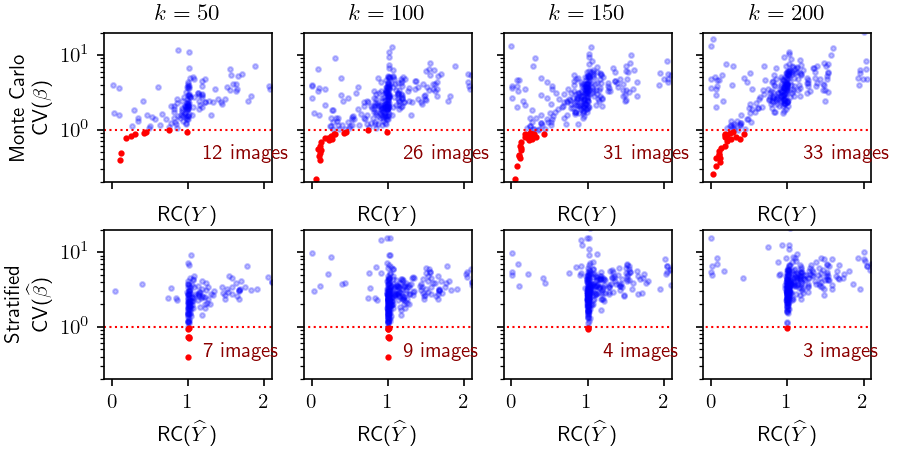
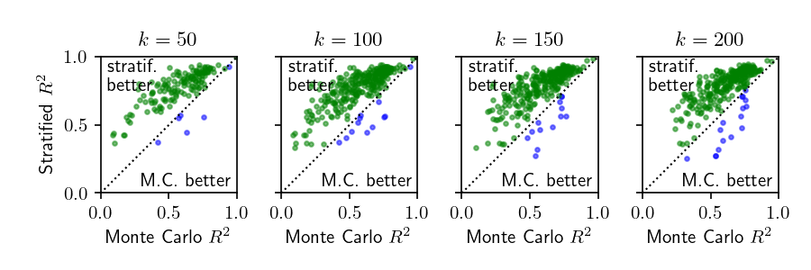
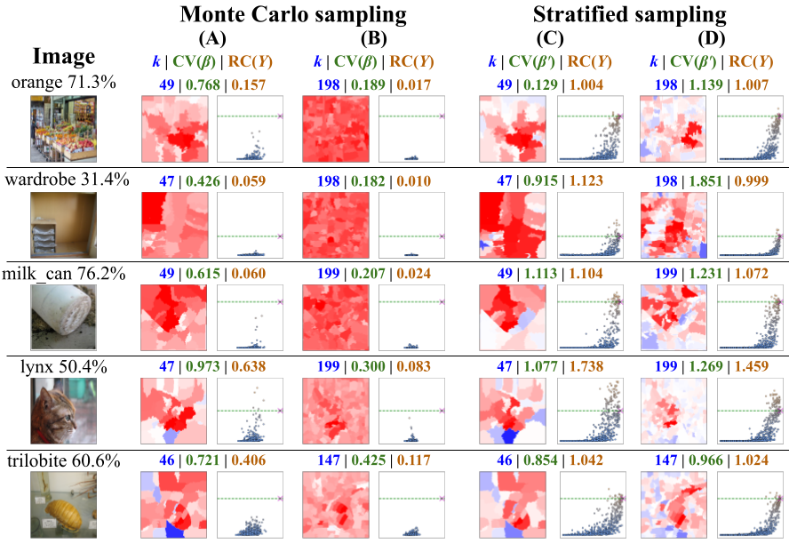

Experiments
===========

This page summarizes the experimental evaluation of the paper. The code to
reproduce it, with pinned library versions, is in
`lime-stratified-examples <https://github.com/rashidrao-pk/lime-stratified-examples>`_.

Setup
-----

* **Model**: ResNet50 pre-trained on ImageNet.
* **Data**: the first 150 images of the
  `ImageNet Object Localization Challenge <https://kaggle.com/competitions/imagenet-object-localization-challenge>`_.
* **Segmentation**: quick shift (``kernel_size=4``, ``ratio=0.2``). For each
  image, ``max_dist`` is found by dichotomic search so that :math:`k = 50`,
  100, 150 and 200 superpixels.
* **Neighborhood**: :math:`n = 1000` samples, mean-filled, default kernel width
  :math:`\sigma = 0.25`.
* **Repetitions**: for every image and every :math:`k`, LIME Image runs 10
  times with Monte Carlo sampling and 10 times with stratified sampling. The
  reported :math:`CV` and :math:`RC` values (see :ref:`metrics`) are averages
  over the 10 runs.

A single image, as k grows
--------------------------

The paper's running example is an image of a hyena, classified correctly with
99.46% probability. With Monte Carlo sampling, the explanation for
:math:`k = 50` still highlights a region. As :math:`k` grows to 200, the
:math:`Y` distribution collapses toward 0, :math:`CV(\beta)` drops, and the
heatmap becomes uniform (paper, Fig. 4).

With stratified sampling, the same image keeps a well-spread :math:`\widehat{Y}`
distribution and a high :math:`CV(\widehat{\beta})` at every :math:`k`. The
highlighted region stays consistent when the segmentation changes. The
:math:`\widehat{Y}` distribution is also clearly *not* homoscedastic across
strata, which is case B in :doc:`method` (paper, Fig. 5).

Results on 150 images
---------------------

   Each dot is one image: :math:`CV` (y-axis) against :math:`RC` (x-axis).
   Top: Monte Carlo. Bottom: stratified. Red dots have an average
   :math:`CV < 1`, which marks confused explanations (paper, Fig. 6).

.. list-table:: Images with average :math:`CV < 1` (out of 150)
   :header-rows: 1

   * - Sampling
     - k = 50
     - k = 100
     - k = 150
     - k = 200
   * - Monte Carlo
     - 12
     - 26
     - 31
     - 33
   * - Stratified
     - 7
     - 9
     - 4
     - 3

With Monte Carlo sampling, the number of confused explanations grows with
:math:`k`, from 12 to 33 of 150 images, and these cases are clearly linked to
low range coverage. Stratified sampling keeps :math:`RC(\widehat{Y})` around 1
or above for almost every image, and the number of confused explanations stays
low: 7 or 9 at :math:`k \le 100`, down to 3 at :math:`k = 200`.

   :math:`R^2` of the surrogate regressor: Monte Carlo (x-axis) against
   stratified (y-axis). Points above the diagonal are images where the
   stratified neighborhood is explained better by the linear model
   (paper, Fig. 6, bottom row).

Qualitative examples
--------------------

   Images from the lower-left tail of the CV/RC plot. Columns A and B use
   Monte Carlo sampling and columns C and D stratified sampling, with
   :math:`k \approx 50` (A, C) and :math:`k \approx 200` (B, D). Each panel
   shows the heatmap and the :math:`Y` distribution, with :math:`k`,
   :math:`CV` and :math:`RC` (paper, Fig. 7).

In column B, the Monte Carlo :math:`Y` values all lie close to 0. The
importance vectors are almost uniform and identify no region. Stratified
sampling still finds a sub-region responsible for the prediction.

Only the last two rows of Fig. 7 show images where the two samplers give
similar explanations. In those images the Monte Carlo neighborhood happens to
be adequate. They are the exception: across the 150 images, Monte Carlo
produces confused explanations (red in Fig. 6) for up to 33 images, while
stratified sampling produces at most 9. Even when both explanations are
non-confused, they need not agree, because Monte Carlo misses the strata close
to :math:`\xi` (case B in :doc:`method`). The :doc:`interactive demo
<demos/sampling/index>` measures this disagreement on real photos.

Takeaways
---------

* The problem appears when the model returns low scores for almost every image
  with about 50% of its superpixels masked. This is common with realistic
  values of :math:`k`.
* Stratified sampling with adjustment factors removes most of these failures,
  and the surrogate model fits the neighborhood better (higher :math:`R^2`).
* The two samplers generally produce *different* explanations. They agree only
  in the idealized homoscedastic case, which real classifiers do not satisfy.
* The method costs nothing extra: the number of model calls :math:`n` is the
  same, and only the sampling distribution and the regression weights change.
