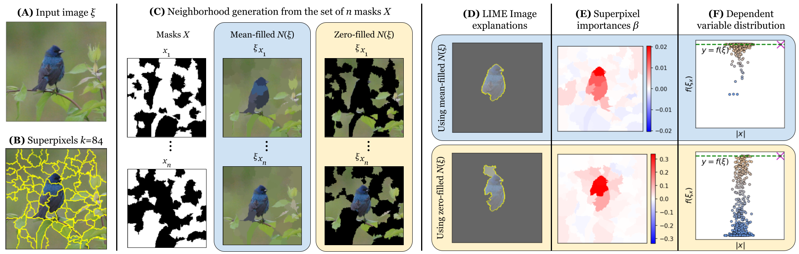

LIME Stratified
===============

**LIME Stratified** is a drop-in modification of
`LIME <https://github.com/marcotcr/lime>`_ that replaces the Monte Carlo
neighborhood sampling of *LIME Image* with an **unbiased stratified sampling**
strategy. It is the reference implementation of the AAAI-24 paper:

    Muhammad Rashid, Elvio G. Amparore, Enrico Ferrari, Damiano Verda.
    |paper|. *Proceedings of the AAAI Conference on Artificial Intelligence*,
    38(13), 14785–14792, 2024.
    `doi:10.1609/aaai.v38i13.29397 <https://doi.org/10.1609/aaai.v38i13.29397>`_
    · `arXiv:2403.17742 <https://arxiv.org/abs/2403.17742>`_

   The LIME Image workflow (paper, Fig. 1): input image (A), superpixels (B),
   neighborhood generation from random masks (C), explanation (D),
   superpixel importances :math:`\beta` (E) and the distribution of the
   dependent variable :math:`f(\xi_x)` against the number of preserved
   superpixels :math:`|x|` (F).

The problem in one paragraph
----------------------------

LIME Image explains a prediction by masking random subsets of superpixels and
fitting a weighted linear regressor on the black-box scores. Each superpixel is
kept with probability 0.5, so the number of kept superpixels follows a
binomial distribution concentrated around :math:`k/2`. With the tens to hundreds
of superpixels that real images need, almost every sample hides about half of
the image. For many images the model's score is near zero for all of these
samples. The regressor is then fit on nearly constant targets, and the
explanation becomes flat and uninformative.

What this package changes
-------------------------

The ``use_stratification=True`` flag of
:meth:`lime.lime_image.LimeImageExplainer.explain_instance` samples masks so
that every *stratum* (number of preserved superpixels :math:`|x| = 0 \dots k`)
is equally likely. Each sample's distance to the photo is then scaled by an
adjustment factor before LIME's kernel turns it into a regression weight (see
:doc:`method`). With
``use_stratification=False`` (the default) the behavior is identical to the
original LIME.

.. code-block:: python

   from lime import lime_image

   explainer = lime_image.LimeImageExplainer(random_state=1234)
   explanation = explainer.explain_instance(image, classifier_fn,
                                            use_stratification=True)

To see the difference on real photos, try the
:doc:`interactive demo <demos/sampling/index>`.

Contents
--------

.. toctree::
   :maxdepth: 2
   :caption: User guide

   installation
   quickstart
   demos/index

.. toctree::
   :maxdepth: 2
   :caption: The paper

   method
   experiments
   citation

.. toctree::
   :maxdepth: 2
   :caption: Reference

   modules

Indices
-------

* :ref:`genindex`
* :ref:`modindex`
* :ref:`search`
