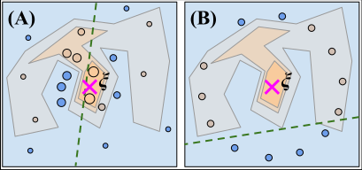
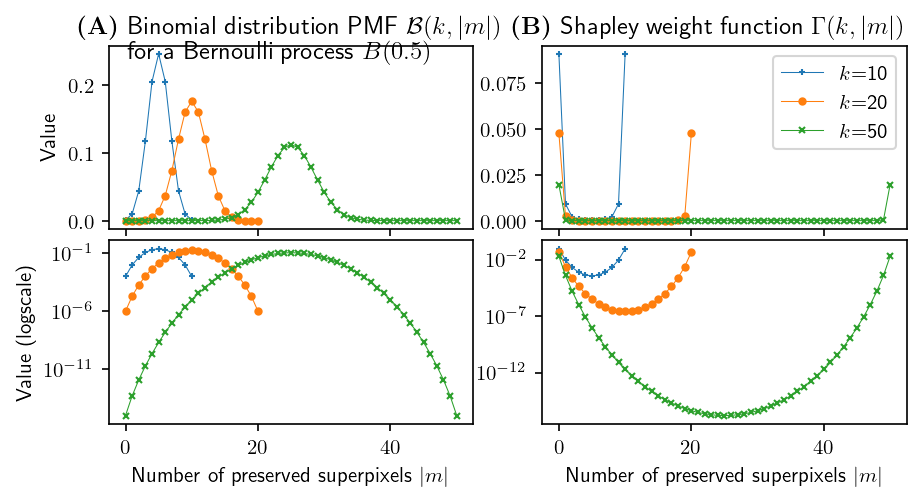

Method
======

This page summarizes the theory of |paper| (AAAI-24) and links each equation to
the code that implements it. Equation numbers match the paper. For the full
derivations, see the `paper <https://doi.org/10.1609/aaai.v38i13.29397>`_
(`arXiv <https://arxiv.org/abs/2403.17742>`_).

.. contents:: On this page
   :local:
   :depth: 1

How LIME Image works
--------------------

Let :math:`f` be a black-box model that returns a score for the explained class,
and let :math:`\xi` be the image being explained. LIME does not explain pixels
directly. It works on an *interpretable representation* of :math:`k`
**superpixels**: contiguous regions produced by a segmentation algorithm such as
quick shift.

A **mask** :math:`x \in \{0,1\}^k` marks each superpixel as preserved (1) or
removed (0). The perturbed image :math:`\xi_x` keeps the preserved superpixels
and replaces the others with their mean color (*mean-filled*, the default) or
with a fixed color such as black (*zero-filled*, ``hide_color=0``). We write
:math:`|x|` for the number of preserved superpixels.

Original LIME Image draws every mask entry independently with an unbiased Monte
Carlo strategy:

.. math::
   :label: eq-bernoulli

   x[i] \sim \mathcal{B}(0.5), \qquad 1 \le i \le k \qquad\text{(Eq. 1)}

:math:`n` masks form the set :math:`X`, the synthetic neighborhood
:math:`N(\xi) = \{\xi_x \mid x \in X\}` and the dependent variables
:math:`Y = \{f(\xi_x) \mid \xi_x \in N(\xi)\}` (Eq. 2). Each sample is weighted
by its proximity to the unmasked image:

.. math::

   w_x = \exp\!\left(-\frac{D(x)^2}{\sigma^2}\right) \qquad\text{(Eq. 3)}

Here :math:`D` is the cosine distance between :math:`x` and the all-ones mask,
and :math:`\sigma = 0.25` is the kernel width. The explanation consists of the
coefficients of a weighted linear regression :math:`Y = X\beta + \epsilon`
(Eq. 4):

.. math::

   \beta = (X^\top W X)^{-1} X^\top W Y \qquad\text{(Eq. 5)}

Each :math:`\beta_i` is the importance of superpixel :math:`i`. The paper
analyses the unregularized estimator. The code, like the original LIME, uses
Ridge regression by default (``model_regressor``).

Why Monte Carlo sampling fails
------------------------------

Under-representation of the neighborhood
^^^^^^^^^^^^^^^^^^^^^^^^^^^^^^^^^^^^^^^^

Under Eq. 1 the number of preserved superpixels :math:`|x|` follows a binomial
distribution :math:`\mathcal{B}(k, |x|)`, which concentrates sharply around
:math:`k/2`. Real images need tens to hundreds of superpixels to follow object
boundaries. At that scale, almost every sample has about half of the image
masked, and practically no sample lies close to :math:`\xi`. The samples form a
"hypersphere" around the instance instead of a local neighborhood.

   \(A) How LIME is supposed to work. (B) How it actually works with Monte Carlo
   sampling when :math:`k` is large: no sample is really close to :math:`\xi`
   (paper, Fig. 2).

Dependent-variable undersampling
^^^^^^^^^^^^^^^^^^^^^^^^^^^^^^^^

If the model still gives meaningful scores when about 50% of the image is
removed, the regression can be fit. In many cases it does not: every
:math:`f(\xi_x)` is close to 0, the :math:`Y` distribution is flat, and the
regression returns almost uniform, very small coefficients. The explanation
becomes *confused*, and it gets worse as :math:`k` grows (paper, Fig. 4).

.. _metrics:

Two diagnostics
^^^^^^^^^^^^^^^

The paper measures this effect with two quantities. :ref:`diagnostics` shows
how to compute them.

* **Coefficient of variation** of the explanation, where values near 0 mean
  that no region stands out:

  .. math::

     CV(\beta) = \frac{\sigma_\beta}{\mu_\beta} \qquad\text{(Eq. 6)}

* **Range coverage** of the dependent variable: the share of the ideal range
  :math:`[0, f(\xi)]` covered by the 1%–99% inter-quantile range of
  :math:`Y`. Values near 0 mean the sampled scores are squashed into a narrow
  band:

  .. math::

     RC(Y) = \frac{\mathrm{IQR}_{1-99}(Y)}{f(\xi)} \qquad\text{(Eq. 7)}

A link with Shapley theory
^^^^^^^^^^^^^^^^^^^^^^^^^^

Shapley values weight a mask :math:`x` by
:math:`\Gamma(k, |x|) = \frac{1}{(k+1)\binom{k}{|x|}}` (Eq. 9). For
:math:`p = 0.5`:

.. math::

   \mathcal{B}(k,|x|)\cdot\Gamma(k,|x|) = \frac{0.5^k}{k+1}

The masks that LIME samples most often are therefore exactly the masks that
Shapley theory considers *least* important, and the reverse also holds. Shapley
estimators such as Owen's multilinear extension (Eq. 10) avoid this by first
drawing a probability :math:`q` and then sampling the mask entries from
:math:`\mathcal{B}(q)`, which covers the whole range of :math:`|x|`. The
proposed method builds on this idea.

   \(A) Binomial PMF of :math:`|x|` under :math:`\mathcal{B}(0.5)`.
   (B) The Shapley weight function. Linear scale (top) and log scale (bottom)
   for :math:`k = 10, 20, 50` (paper, Fig. 3).

Stratified sampling for LIME Image
----------------------------------

Strata
^^^^^^

Let :math:`\mathcal{X}^{(i)}` be the set of all masks with exactly :math:`i`
preserved superpixels. The :math:`k+1` strata
:math:`\mathcal{X}^{(0)}, \dots, \mathcal{X}^{(k)}` partition
:math:`\{0,1\}^k`, and their sizes are known in advance:

.. math::

   |\mathcal{X}^{(i)}| = \binom{k}{i}, \qquad 0 \le i \le k \qquad\text{(Eq. 11)}

Monte Carlo sampling picks stratum :math:`i` with probability
:math:`\binom{k}{i}/2^k`. The proposed sampler instead builds an *oversampled*
population :math:`\widehat{X}` in which every stratum has the same probability
:math:`1/(k+1)`. This oversamples the rare masks near
:math:`\xi` (:math:`|x| \to k`) and far from it (:math:`|x| \to 0`).

Adjustment factor
^^^^^^^^^^^^^^^^^

Uniform strata would bias the regression. To keep it unbiased, each sample in
stratum :math:`i` is reweighted by the ratio of the two stratum probabilities:

.. math::

   \mathrm{adj}(i)
   = \frac{\Pr[x \in \mathcal{X}^{(i)} \mid x \in \mathcal{X}]}
          {\Pr[x \in \mathcal{X}^{(i)} \mid x \in \widehat{\mathcal{X}}]}
   = \frac{(k+1)\binom{k}{i}}{2^k} \qquad\text{(Eq. 12)}

The paper inserts the adjustment factor into the LIME weight of Eq. 3, and the
explanation is the weighted least-squares estimate on the stratified
neighborhood:

.. math::

   \widehat{\beta} = (\widehat{X}^\top \widehat{W} \widehat{X})^{-1}
                     \widehat{X}^\top \widehat{W} \widehat{Y} \qquad\text{(Eq. 13)}

.. important::

   **How the implementation applies the factor.** The paper's text describes
   :math:`\widehat{w}_{\hat{x}}` as the Eq. 3 weight multiplied by
   :math:`\mathrm{adj}(|\hat{x}|)`. The code that produced all of the paper's
   results applies the factor to the *distance*, inside the kernel:

   .. math::

      \widehat{w}_{\hat{x}} = \exp\!\left(-\frac{\big(D(\hat{x})\cdot
      \mathrm{adj}(|\hat{x}|)\big)^2}{\sigma^2}\right)

   (with LIME's kernel, the square root of this). That code is the
   `lime-stratified-examples
   <https://github.com/rashidrao-pk/lime-stratified-examples>`_ repository and
   the ``lime-stratified 0.0.1`` package on PyPI. This library does the same,
   so it reproduces the paper's figures. The difference matters: on the
   paper's *orange* image at :math:`k = 50`, this weighting gives
   :math:`CV(\widehat{\beta}) = 2.11`, as in the paper's Fig. 7 (2.12).
   Multiplying the kernel weights by :math:`\mathrm{adj}` instead gives 0.39,
   no better than Monte Carlo (0.39). Since :math:`\mathrm{adj}` is small at
   both ends of the strata and large in the middle, this weighting keeps the
   samples near :math:`|x| = 0` and :math:`|x| = k` in the regression, and it
   shrinks the weight of the mid-strata samples that Monte Carlo
   over-represents.

When stratification matters
^^^^^^^^^^^^^^^^^^^^^^^^^^^

Suppose the importances differ from stratum to stratum,
:math:`\widehat{Y}^{(i)} = \widehat{X}^{(i)}\widehat{\beta}^{(i)} + \widehat{\epsilon}^{(i)}`
(Eq. 14). The paper considers two cases.

* **Case A** (an idealized assumption): mean and variance of
  :math:`\widehat{\beta}^{(i)}` do not depend on the stratum (homoscedastic).
  *Only under this assumption* is the stratified estimate expected to converge
  to the Monte Carlo one, whatever the strata ratios in the neighborhood.
* **Case B**: mean and variance of :math:`\widehat{\beta}^{(i)}` vary by
  stratum. Monte Carlo sampling cannot see the strata near :math:`\xi`, which
  are exactly the strata that describe the local behavior of :math:`f`. The
  two samplers then produce *different* explanations, and stratified sampling
  with adjustment factors is strongly advisable.

Real image classifiers are not in case A. The paper's own stratified
neighborhoods show a :math:`\widehat{Y}` distribution that is far from
homoscedastic across strata (Fig. 5C), so in practice the two samplers should
be expected to disagree, increasingly so as :math:`k` grows.

Algorithm
---------

The paper's Algorithm 1 contrasts the two samplers:

.. code-block:: text

   function MonteCarloSampling(n, k)
       X <- n x k matrix
       for i in 1..n:
           for j in 1..k:
               X[i, j] <- B(0.5)

   function StratifiedSampling(n, k)
       X <- n x k matrix
       for i in 1..n:
           q <- Uniform(0, 1)
           for j in 1..k:
               X[i, j] <- B(q)
           adj[i] <- (k + 1) * binom(k, |X[i]|) / 2^k

Drawing :math:`q \sim U(0,1)` first and then :math:`x[j] \sim \mathcal{B}(q)`
makes :math:`|x|` uniform over :math:`\{0, \dots, k\}`, so every stratum is
equally likely. Unlike fitting one regressor per stratum, this needs only a
small change to the LIME code.

Mapping to the implementation
-----------------------------

.. list-table::
   :header-rows: 1
   :widths: 35 65

   * - Paper
     - Code
   * - ``use_stratification`` switch
     - :meth:`lime.lime_image.LimeImageExplainer.explain_instance`
       (``use_stratification=False`` reproduces the original LIME exactly)
   * - Algorithm 1, ``StratifiedSampling``
     - :meth:`lime.lime_image.LimeImageExplainer.data_labels`: for each row,
       ``q = random_state.uniform(0, 1)`` and
       ``data[i, :] = random_state.rand(k) < q``
   * - Eq. 12, :math:`\mathrm{adj}(i)`
     - ``binom(k, data[i].sum()) / 2**k * (k + 1)`` in
       :meth:`~lime.lime_image.LimeImageExplainer.data_labels`, returned as
       ``weight_adjustments``
   * - :math:`\widehat{w}` and Eq. 13
     - :meth:`lime.lime_base.LimeBase.explain_instance_with_data` multiplies
       the distances by ``weight_adjustments``, applies the kernel, and uses
       the result as sample weights before fitting the
       regressor
   * - Explained instance :math:`\xi`
     - Row 0 of the neighborhood is always the unmasked image (all ones),
       with adjustment factor 1

Limitations and future work
---------------------------

The paper names several limitations and directions for future work:

* The derivations assume no regularization. They should extend to Ridge
  regression because only the sampling changes.
* The experiments cover image data. Other data types have non-Boolean
  interpretable spaces and would need adjustments.
* Other designs are possible: a mixture model with one regressor per stratum,
  or a formulation that gives uniform weight to all strata as Shapley theory
  suggests.
* LIME's kernel itself does not capture neighborhood locality well. Revising
  it is left to future work.
